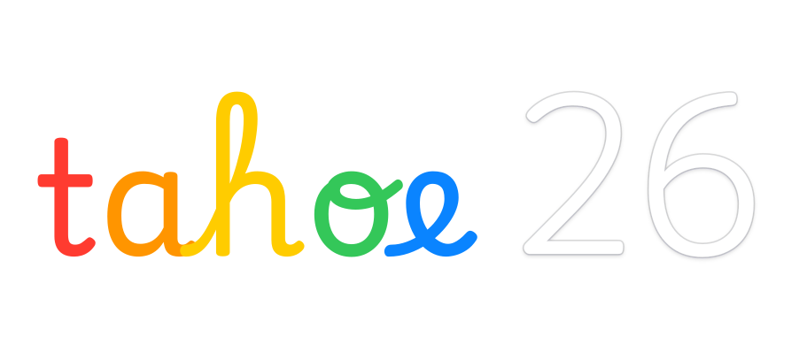
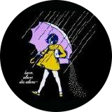
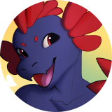
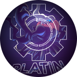

<p align="center">
  
</p>

# macOS Tahoe Liquid Theme for Plasma 6.7/6.8+

[](https://github.com/lestercorderomurillo/macos-tahoe-liquid-kde/releases) [](https://github.com/lestercorderomurillo/macos-tahoe-liquid-kde/actions/workflows/test.yml) [](https://kde.org/plasma-desktop/) [](LICENSE) [](https://github.com/lestercorderomurillo/macos-tahoe-liquid-kde/issues/new)

macOS Tahoe-inspired glass, Dock, global menu and app themes for KDE Plasma 6.6–6.8.

> [!CAUTION]
> Experimental. Desktop updates may break compatibility. Avoid production systems; [report issues here](https://github.com/lestercorderomurillo/macos-tahoe-liquid-kde/issues/new).

<br>


### Acrylic Glass Tahoe Launcher

<p align="center">
  
  
</p>

<br>

### Acrylic Glass Tahoe Dock

Glass refraction, hover zoom, notification badges and auto-hide.

<p align="center">
  
</p>

<br>

### Acrylic Glass Tahoe Finder

Finder-style Nautilus in light and dark.

<p align="center">
  
  
</p>

<br>

### Acrylic Glass Tahoe Menu

System controls and global menus for compatible apps.

<p align="center">
  
  
</p>

<br>

### System Information

<p align="center">
  
  
</p>

<br>

### Plasma Theme

<p align="center">
  
  
</p>

<br>

### Boot Splash

Plymouth startup and shutdown theme with LUKS2 unlock support.

<p align="center">
  
  
</p>

<br>


**Graphical installer**

```bash
./installer
```

**Terminal wizard**

```bash
sudo ./install
sudo ./uninstall
```

English, Spanish and Simplified Chinese. All options: `sudo ./install --help`.

<details>
<summary><b>Requirements</b></summary>

- KDE Plasma 6.6+
- Python 3.10+
- `sudo`
- Qt 6 development tools
- KDE and Qt 6 development packages for the compiled plasmoids and KWin effects
- `cmake`, `g++`, and `pkg-config` when compiled features are selected
- `dbus-send`
- `systemctl` or `crontab` for scheduled features

Assets are bundled. Missing dependencies and optional KDE Rounded Corners require internet access.

| Distro | Qt 6 tools | KDE Plasma 6 development packages |
|--------|------------|-----------------------------------|
| Arch family | `pacman -S qt6-tools` | `pacman -S extra-cmake-modules plasma-workspace kdecoration libplasma libnotificationmanager libksysguard plasma-activities-stats` |
| Fedora family | `dnf install qt6-qttools-devel` | `dnf install extra-cmake-modules plasma-workspace-devel kdecoration-devel libplasma-devel knotifications-devel libksysguard-devel kf6-plasma-activities-devel` |
| openSUSE Tumbleweed | `zypper install qt6-tools-devel` | `zypper install extra-cmake-modules plasma6-workspace-devel kdecoration-devel libKF6Plasma-devel libnotificationmanager6-devel libksysguard6-devel libKF6PlasmaActivitiesStats6-devel` |

</details>

<details>
<summary><b>Choose features and theme mode</b></summary>

Flags skip the wizard. Exclude components with `--no-<name>` or select them with `--only`:

```bash
sudo ./install --no-gtk --no-sddm
sudo ./install --only --fonts --icons
sudo ./uninstall --only --cursors
```

**Features**

`wallpapers`, `fonts`, `cursors`, `plasma-theme`, `window-decorations`, `kvantum`, `color-schemes`, `icons`, `plasmoids`, `globalmenu`, `acrylic-glass`, `rounded-corners`, `global-theme`, `layout`, `sounds`, `gtk`, `firefox`, `sddm`, `apps`, `nautilus`, `nautilus-bookmarks`, `portals`, `oled-care`, `plymouth`.

**Theme mode**

```bash
sudo ./install          # auto: light at 06:00, dark at 18:00
sudo ./install --light
sudo ./install --dark
```

**Live switching**

```bash
mac-tahoe-theme-switch light
mac-tahoe-theme-switch dark
mac-tahoe-theme-switch auto
```

**Saved choices**

```bash
sudo ./install --no-gtk --dark --save
sudo ./install --reset
```

**Maintenance**

- `--preflight` checks the system without installing.
- `--no-apply-theme` stages files without switching the desktop.
- `--no-grub-modify` leaves `/etc/default/grub` unchanged.
- Theme changes keep any wallpaper you've chosen for each monitor.
- `--reset-wallpapers` returns all monitors to the bundled light/dark wallpapers.
- Both Tahoe and Golden Gate light/dark wallpapers are bundled. Tahoe is the default;
  the [Golden Gate edition](https://github.com/lestercorderomurillo/macos-golden-gate-liquid-kde)
  downloads this implementation and selects Golden Gate through `src/scripts/defaults.json`.
- Choose **1 — Tahoe** or **2 — Golden Gate** from the Launcher's **…** menu.
- `./legacy-install` and `./legacy-uninstall` use the classic prompt instead of the terminal wizard.

</details>

<details>
<summary><b>Glass and rounded-corner troubleshooting</b></summary>

- **Plasma 6.8:** reinstall to rebuild the effects and install the shader fixes, then log out and back in. An enabled checkbox alone does not confirm Acrylic Glass is rendering; the installer warns when activation cannot be verified.
- **Corner artifacts:** Acrylic Glass follows the active Rounded Corners cutout and clips both glass and grain to it ([#89](https://github.com/lestercorderomurillo/macos-tahoe-liquid-kde/issues/89)). Independent radii remain available when Rounded Corners does not affect a surface; reinstall preserves custom values.
- **Desktop-edit overlay:** Rounded Corners excludes desktop surfaces before offscreen redirection, even with explicit inclusion rules ([#77](https://github.com/lestercorderomurillo/macos-tahoe-liquid-kde/issues/77)). The guard is verified in an isolated compositor; the originally reported NVIDIA desktop-edit session still needs confirmation.
- VirtualBox VM windows are excluded from glass to preserve seamless cutouts ([#90](https://github.com/lestercorderomurillo/macos-tahoe-liquid-kde/issues/90)). The manager is unaffected.

</details>

<details>
<summary><b>Firefox theme</b></summary>

Supports native, Flatpak and Snap profiles. Restart Firefox after installation.
Browser data and customizations are preserved; uninstall removes the theme's additions. UI backups: `~/.local/state/mac-tahoe-liquid-kde/firefox/snapshots/`.

</details>

<details>
<summary><b>OLED care</b></summary>

Optional panel shifts; disabled by default.

```bash
sudo ./install --oled-care
sudo ./install --oled-care --save
sudo ./install --no-oled-care
sudo ./install --oled-care --oled-interval=3 --oled-max-shift=4
```

**Manual controls**

```bash
mac-tahoe-oled-care shift
mac-tahoe-oled-care restore
mac-tahoe-oled-care status
```

</details>

<details>
<summary><b>Test in a virtual machine</b></summary>

```bash
./vm <os>
```

**OS:** `cachyos` · `arch` · `manjaro` · `endeavouros` · `garuda` · `fedora` · `nobara` · `opensuse` · `neon`

`all` launches every distro.

</details>

<details>
<summary><b>Reduced transparency</b></summary>

`./installer` → **Features → Transparency → Standard / Reduced → Apply now**.

```sh
mac-tahoe-theme-switch transparency reduced
```

Applies to bundled Plasma, Kvantum and GTK themes and persists across theme
switches and login. Reopen GTK apps if needed. Restore with
`mac-tahoe-theme-switch transparency standard`.

</details>

<details>
<summary><b>NixOS and Home Manager (testing)</b></summary>

Use the flake modules, **not `sudo ./install`**. Live desktop validation is pending.

**Flake input** (requires Nixpkgs and Home Manager):

```nix
inputs.mac-tahoe = {
  url = "github:lestercorderomurillo/macos-tahoe-liquid-kde/v0.55.1";
  inputs.nixpkgs.follows = "nixpkgs";
  inputs.home-manager.follows = "home-manager";
};
```

**NixOS:** import `inputs.mac-tahoe.nixosModules.default`.

```nix
services.desktopManager.plasma6.enable = true;
services.mac-tahoe.enable = true;
# services.mac-tahoe.plymouth.enable = true; # optional boot splash
```

**Home Manager:** import `inputs.mac-tahoe.homeManagerModules.default`.

```nix
programs.mac-tahoe = {
  enable = true;
  mode = "auto"; # or "light" / "dark"
  # reducedTransparency = true;
  # appleAssets = true;
  # oledCare.enable = true;
};
```

**Apple assets:** optional non-free fonts, wallpapers and sounds. Enabling
`appleAssets` also requires:

```nix
nixpkgs.config.allowUnfreePredicate = pkg:
  builtins.elem (lib.getName pkg) [ "mac-tahoe-apple-assets" ];
```

**Panels:** also import your own plasma-manager module and
`inputs.mac-tahoe.homeManagerModules.plasma-manager`. Enable
`programs.mac-tahoe.panels.enable` and set `programs.mac-tahoe.panels.launchers`,
e.g. `[ "applications:org.kde.dolphin.desktop" ]`. This replaces the layout
without importing existing pins.

**Writable settings:** keep `kdeglobals`, `kwinrc`, `plasmarc`, `plasmashellrc`,
`kcminputrc`, `plasma-org.kde.plasma.desktop-appletsrc`,
`Kvantum/kvantum.kvconfig` and live GTK configuration writable. Avoid immutable
plasma-manager keys managed by the theme switcher. `reducedTransparency = null`
allows CLI control; a boolean gives Home Manager control.

Log out and back in after activation. Firefox profiles, GTK bookmarks and SDDM
are not configured. GTK global menus need `programs.mac-tahoe.gtkAppmenuModule`.
Before disabling OLED care, run `mac-tahoe-oled-care restore`; before removing
the modules, select Breeze. Removal leaves user settings in place.

</details>

<br>


<details>
<summary><b>Distributions</b></summary>

| | Name | Status |
|:--:|------|---------|
|  | CachyOS |  |
|  | Arch Linux |  |
|  | EndeavourOS |  |
|  | Fedora |  |
|  | Manjaro |  |
|  | Artix Linux (OpenRC) |  |
|  | Garuda Linux |  |
|  | Nobara |  |
|  | openSUSE Tumbleweed |  |
|  | KDE neon |  |

Gentoo support was dropped in v0.54.7 because its maintenance is too complex for
this project. Anyone wishing to continue it will need to maintain it separately.

</details>

<details>
<summary><b>Init systems</b></summary>

| Init system | Support | Testing |
|-------------|---------|---------|
| systemd | Supported | Completed |
| OpenRC | Supported | In progress |

OpenRC scheduled features require a running cron daemon. Artix has container
validation; live installation testing is pending.

</details>

<details>
<summary><b>Plasma versions</b></summary>

| Plasma | Support | Since |
|--------|---------|-------|
| 6.5 and older | Not supported | Not applicable |
| 6.6 | Supported | v0.1.0 |
| 6.7 | Supported | v0.19.0 |
| 6.8 | Supported | v0.54.1 |

</details>

<br>


<details>
<summary><b>Component status</b></summary>

| Component | Status |
|-----------|--------|
| Color Schemes | Available |
| Wallpapers | Available |
| Fonts | Available |
| Cursors | Available |
| Plasma Theme | Available |
| Kvantum Theme | Available |
| GTK Theme | Available |
| Acrylic Glass | Available |
| KDE Rounded Corners | Available |
| Auto Theme Switcher | Available |
| OLED Care | Available |
| Installer UI | Available |
| Installer TUI | Available |
| Localization | Available |
| Aurorae Decorations | Available |
| Global Menu | Available |
| Dock Task Manager | Available |
| Nautilus | Available |
| Launcher | Available |
| Trash | Available |
| Sounds | Available |
| Boot Screen | Available |
| Shutdown Screen | Available |
| Firefox Theme | Available |
| Icons | In progress |
| Multi-Distro Support | In progress |
| OpenRC Testing | In progress |
| Konsole Theme | Planned |
| Kate Theme | Planned |
| SDDM Theme | Planned |
| Calendar | Planned |
| Control Center | Planned |
| System Preferences | Planned |
| OS Selector | Planned |

</details>

<br>


<p>
  <a href="https://github.com/lestercorderomurillo"></a>
  <a href="https://github.com/yanhenrique-dev"></a>
  <a href="https://github.com/tuxkt"></a>
  <a href="https://github.com/caioniehues"></a>
  <a href="https://github.com/404-not-found129"></a>
  <a href="https://github.com/myakupozluk"></a>
  <a href="https://github.com/EMS1998"></a>
  <a href="https://github.com/allfritz"></a>
  <a href="https://github.com/elegos"></a>
  <a href="https://github.com/kozeki-uii"></a>
  <a href="https://github.com/imightbelosthere"></a>
  <a href="https://github.com/evaildev"></a>
  <a href="https://github.com/xarblu"></a>
  <a href="https://github.com/PKMNPlatin"></a>
  <a href="https://github.com/matinlotfali"></a>
  <a href="https://github.com/luisbocanegra"></a>
  <a href="https://github.com/OliverChase2003"></a>
</p>

**[Report a bug](https://github.com/lestercorderomurillo/macos-tahoe-liquid-kde/issues/new)** or use **Apple menu → About This Computer → Report a Bug…**.

Include:

- Your Plasma version: `plasmashell --version`
- Your distro: `grep PRETTY_NAME /etc/os-release`
- The theme version: `cat VERSION`
- A screenshot or recording for visual issues

Keep pull requests focused and validate with `./vm`. See [CONTRIBUTING.md](CONTRIBUTING.md).

<br>


This is an independent reimplementation inspired by the macOS aesthetic. It is not affiliated with or endorsed by Apple or KDE. "macOS" and "Apple" are trademarks of Apple Inc.

The bundled wallpapers, system sounds, and SF Pro / SF Mono fonts remain Apple's property and are not covered by this project's license. All other code and theme assets are original or derived from compatibly licensed open-source work.

Licensed [GPL-3.0](LICENSE).

<br>


<details>
<summary><b>Projects, assets and acknowledgements</b></summary>

Thanks to the open-source projects that inspired this one or fed assets into it. Everything here is maintained independently:

- **[EliverLara](https://github.com/EliverLara/TahoeLauncher)**: `TahoeLauncher`, the inspiration for the Launcher plasmoid.
- **[vinceliuice](https://github.com/vinceliuice)**: `MacTahoe-icon-theme` for the icons, cursors, and GTK inspiration; and the [`MacTahoe-gtk-theme` Firefox CSS/SVG](https://github.com/vinceliuice/MacTahoe-gtk-theme/tree/main/other/firefox), maintained here as an MIT-licensed fork and integrated with this project's profile backup and restore system.
- **[taj-ny](https://github.com/taj-ny/kwin-effects-forceblur)** and **[4v3ngR](https://github.com/4v3ngR/kwin-effects-glass)**: Better Blur and its glass fork, the starting point of the Acrylic Glass effect (the KWin blur authors stay credited in the source headers).
- **[luisbocanegra](https://github.com/luisbocanegra/plasma-panel-colorizer)**: `plasma-panel-colorizer` v7.3.0, bundled offline and installed by the layout step to tint the panels (GPL-3.0, license shipped alongside).
- **[Matin Lotfaliei / KDE-Rounded-Corners](https://github.com/matinlotfali/KDE-Rounded-Corners)**: the GPL-3.0 KWin rounded-window effect, fetched from the pinned v0.9.0 release and built online against the host KWin SDK (license installed alongside).
- **[ful1e5](https://github.com/ful1e5)**: `apple_cursor`, inspiration for an alternate macOS-style cursor.
- **[sahibjotsaggu](https://github.com/sahibjotsaggu)**: `San-Francisco-Pro-Fonts`, where the SF Pro / SF Mono bundle comes from.
- **[Lucide](https://github.com/lucide-icons/lucide)**: copy icons bundled in the global menu (ISC, © Lucide Contributors).
- **[512pixels.net](https://512pixels.net/projects/default-mac-wallpapers-in-5k/)**: high-resolution macOS wallpaper archive.

Please support their efforts too: star their repos, report bugs upstream, and contribute back when you can.

If a credit is missing, please [open an issue](https://github.com/lestercorderomurillo/macos-tahoe-liquid-kde/issues/new).

</details>
